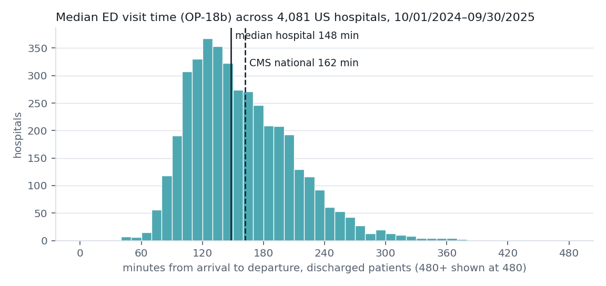

# ER or Urgent Care?

Public hospital emergency-department times, explained with the uncertainty left in.

Pick a US ZIP (or one of five demo areas) and check what is going on. The page:

1. **Puts safety first.** A short red-flag checklist, paraphrased from MedlinePlus. Chest pain,
   stroke signs, trouble breathing and similar items turn the page into a large *Call 911*
   message and grey out the time comparison, because averages do not apply to emergencies.
2. **Shows the nearest emergency departments** with CMS's published median visit time
   (OP-18b), an *assumed* range of visit lengths, the chance of going over 4 hours, the
   hospital's rank among other hospitals in its state and nationally, its ED-volume category,
   the share of patients who left before being seen, and the CMS footnote when a value is
   "Not Available".
3. **Lists nearby urgent-care clinics** from OpenStreetMap for the demo areas, and says plainly
   that no public source publishes urgent-care wait times, so none is shown.

It runs from a file: open `site/index.html` in a browser. No server, no network calls, nothing
the user types leaves the device.



## Quick start

```sh
make venv          # .venv with matplotlib, reportlab, pypdf, pytest
make test          # 27 tests, offline, about 3 seconds
open site/index.html
```

Deep links for demos: `site/index.html#zip=14850&check=cold`, `#zip=60611&check=chest`,
`#zip=94539&sigma=0.8`.

Rebuild everything from the public sources:

```sh
make data          # curl CMS (via its metastore), Census gazetteer, Overpass (cached) into data/raw/
make trim          # data/raw/ -> data/*.csv, data/*.json (committed, about 1.7 MB)
make build         # data/ -> site/data.js, docs/*.png, docs/ER-or-Urgent-Care.pdf
```

`make all` runs venv, data, trim, build and test in order. Overpass is queried once per demo
metro, sequentially, and never again while `data/raw/osm_*.json` exists.

## How it meets the DSH Hacks V2 requirements

| Requirement | Where |
|---|---|
| Interactive prototype | `site/index.html` (static; also served on GitHub Pages) |
| Demo video | shot list in [DEMO-SCRIPT.md](DEMO-SCRIPT.md) |
| One-page project description PDF | [docs/ER-or-Urgent-Care.pdf](docs/ER-or-Urgent-Care.pdf), built by `eruc/onepager.py`, a test asserts it is exactly one page |
| GitHub repo | this repository |

Judging criteria: the idea (safety-first routing plus honest public data), implementation
(tested pipeline from raw CMS files to a self-contained page), design (accessible, mobile-first,
works offline), presentation (one-pager, charts, method write-up).

## The statistics, briefly

OP-18b is a hospital-level **median** of total ED time for discharged patients
(10/01/2024 to 09/30/2025). It is not time-to-be-seen and not live, and CMS publishes no
spread. The range on each card assumes a lognormal with the median pinned at OP-18b and
dispersion σ = 0.6 (0.4 to 0.8 shown as a band, adjustable with a slider). Every number that
depends on σ is labelled "assumed". Ranks are computed from the CMS file. Full write-up:
[docs/METHOD.md](docs/METHOD.md).

## Layout

```
eruc/            Python package: fetch, trim, stats, site, charts, onepager
site/            index.html, styles.css, core.js (pure logic), app.js (DOM), data.js (built)
data/            committed trimmed caches; data/raw/ is gitignored
docs/            METHOD.md, charts, one-page PDF
tests/           pytest suite; tests/js/ runs core.js and app.js under Node
```

## Tech stack

Python 3.11 standard library (csv, statistics, bisect) for the pipeline; matplotlib for charts;
reportlab for the PDF; pypdf and pytest for tests; plain HTML, CSS and JavaScript for the site
(no frameworks, no CDN). Node is used only by the tests, to run the same JavaScript the page runs.

## Data and attribution

- CMS Provider Data Catalog: Timely and Effective Care - Hospital, Hospital General
  Information, Timely and Effective Care - National, Footnote Crosswalk (data.cms.gov).
- U.S. Census Bureau 2025 ZCTA Gazetteer (ZIP centroids).
- Urgent-care listings © OpenStreetMap contributors, ODbL
  (<https://www.openstreetmap.org/copyright>).
- Symptom guidance paraphrased from MedlinePlus, *When to use the emergency room - adult*.

Not medical advice. In an emergency, call 911.

MIT License, Copyright (c) 2026 Joshua Yeung.
