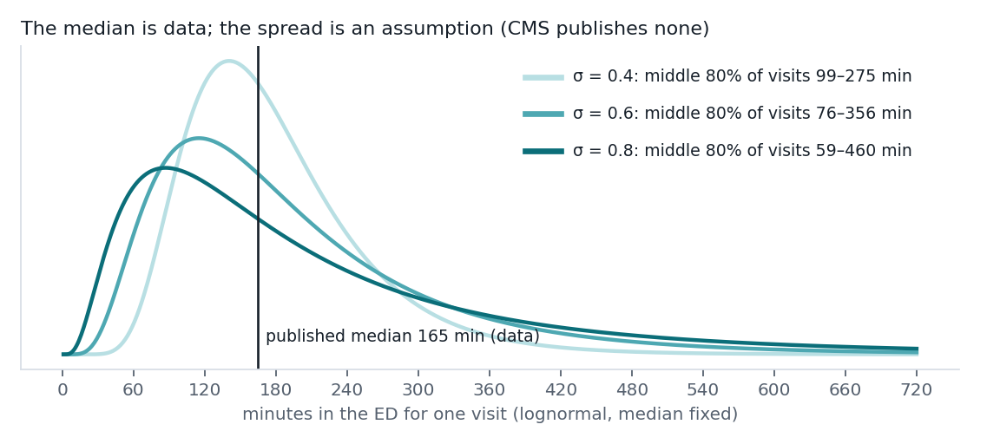
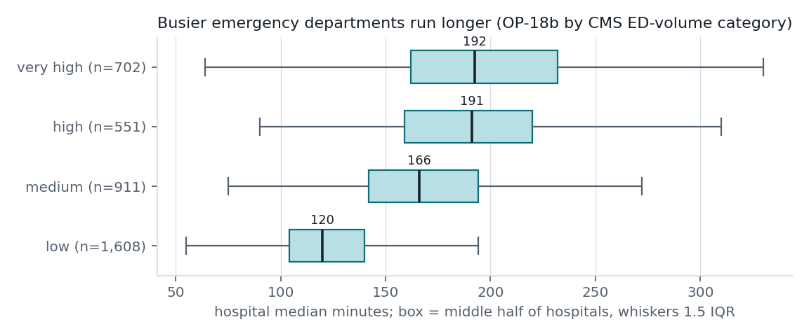

# Method: what the numbers mean, and what they do not

This page explains every number the prototype shows. The same text, shorter, is in the
"How to read these numbers" section of the site.

## 1. The measure: CMS OP-18b

**OP-18b** is published by the Centers for Medicare & Medicaid Services (CMS) in the
*Timely and Effective Care - Hospital* dataset. CMS names it "Average (median) time patients
spent in the emergency department before leaving from the visit, excluding patients
transferred to another facility or psychiatric care/mental health patients."

In plain terms: for each hospital, the **median minutes from arriving at the emergency
department to leaving it, for patients who were sent home**.

| | |
|---|---|
| Reporting period (OP-18b, OP-18c) | 10/01/2024 to 09/30/2025 |
| Reporting period (EDV volume, OP-22 left before being seen) | 01/01/2024 to 12/31/2024 |
| Hospitals with ED measures | 4,658 |
| Hospitals with a numeric OP-18b | 4,081 |
| "Not Available" | 577 (footnote 5 "Results are not available for this reporting period": 398; footnote 19 "Data are shown only for hospitals that participate in the IQR and OQR programs": 172; too few cases / other: 7) |
| Numeric but footnote 3 ("based on a shorter time period than required") | 159 |
| CMS national OP-18b | 162 min |
| Median across hospitals (my calculation, unweighted) | 148 min |
| Across hospitals, 10th / 25th / 75th / 90th percentile | 100 / 119 / 188 / 225 min |
| CMS national median by ED volume: low / medium / high / very high | 123 / 165 / 202 / 201 min |

The CMS national figure (162) is higher than the median hospital (148). The likely reason is
that large, busy departments are slower and handle more visits; the by-volume figures above
point the same way. I show both and do not mix them.

Also shown where present:

- **OP-18c**: the same median for psychiatric / mental-health patients.
- **OP-22**: percent of patients who left before being seen.
- **EDV**: CMS's ED-volume category (low, medium, high, very high).
- **Sample**: the number of cases the hospital's value is based on.

## 2. What it is not

- **Not the time until you see a clinician.** It is the whole visit: triage, waiting, tests,
  treatment and discharge paperwork.
- **Not a live wait.** It summarizes 12 months that ended 09/30/2025. Time of day, season and
  local events can move tonight's wait a long way from it.
- **Not your time.** EDs see the sickest first. The measure also excludes admitted patients,
  so it says nothing about how long a seriously ill patient will be there.
- **Not a quality score.** A longer median can reflect a sicker population, a trauma center,
  or a busy urban department.

## 3. Uncertainty: what is data and what is assumed

CMS publishes **one number per hospital and no spread**. Anything wider than that one number
is an assumption, and the site labels it as one.

**Assumed visit-to-visit spread.** I model one discharged visit's duration `T` as lognormal
with its median fixed at the hospital's OP-18b value `m`:

    ln T ~ Normal(ln m, σ²)

The lognormal is a standard right-skewed model for durations: most visits cluster around the
median and a long tail runs late. **σ is my assumption, not an estimate**: no CMS field
supports it, and I am not citing a literature value (I did not verify one). The default is
σ = 0.6, the site always also shows the range over σ = 0.4 to 0.8, and a slider lets the
reader set σ anywhere from 0.3 to 1.0.

From this the site computes, for each hospital:

- the middle 80% of visits: `m · exp(±1.2816 σ)`. At σ = 0.6 that is about 0.46× to 2.16× the
  median, so a 165-minute median gives roughly 76 to 356 minutes;
- the chance a visit runs over 4 hours: `1 − Φ((ln 240 − ln m) / σ)`, with the value at σ = 0.4
  and σ = 0.8 shown beside it.

**Precision of the median itself.** The published median is estimated from `n` cases. Under
the same lognormal, the large-sample standard error of a sample median is

    SE = 1 / (2 f(m) √n) = m · σ · √(π / (2n))

because the lognormal density at its median is `f(m) = 1 / (m σ √(2π))`. With n ≈ 350 and
σ = 0.6 that is about 4% of the median (around 10 minutes for a 4-hour median), much smaller
than the visit-to-visit spread. The test suite checks this formula against a simulation.

## 4. Regional context

For each hospital with a numeric OP-18b, the site reports the share of **other** hospitals,
in the same state and nationally, whose median is longer (ties count half; the hospital is
left out of its own comparison). "Shorter than 18% of other NY hospitals" means 82% of New
York hospitals that report OP-18b have a shorter median. These ranks are computed from the CMS
file, not taken from CMS.

Because busier departments run longer, each card also shows the CMS national median for the
hospital's own ED-volume category, which is the fairer comparison.

## 5. Location and distance

Hospital General Information has a street address but no coordinates. I place each hospital at
the centroid of its ZIP Code Tabulation Area from the U.S. Census 2025 ZCTA Gazetteer, and the
user at the centroid of the ZIP they type. Distances are straight-line between those two
centroids, labelled "ZIP-centroid distance" in the UI. They are not drive times.
114 hospitals have a ZIP that is not a ZCTA (often a PO-box ZIP) and are left out of distance
results; they still count in the state and national ranks. 361 hospitals that CMS lists
without emergency services are hidden from the nearby list.

## 6. Urgent care

**No public source publishes urgent-care wait times. The prototype does not show or estimate
one.** Urgent-care locations come from OpenStreetMap (© OpenStreetMap contributors, ODbL),
fetched once per demo area (Ithaca, New York City, Fremont / Bay Area, Miami, Chicago) with
a single Overpass query each, matching any of these taggings:

- `healthcare=clinic` with `healthcare:speciality` containing `urgent`
- `urgent_care=yes` (on `amenity=clinic` or any `healthcare=*`)
- `healthcare=urgent_care` or `amenity=urgent_care`
- a name containing "Urgent Care"

Veterinary and pet clinics and hospitals are removed; duplicates (same name, same spot) are
merged. OpenStreetMap coverage is uneven: Ithaca has one tagged clinic, New York City 106.
Outside the demo areas the site says urgent-care listings are not cached.

## 7. The symptom checklist

The red-flag and urgent-care items are paraphrased from MedlinePlus (U.S. National Library of
Medicine), *When to use the emergency room - adult*,
<https://medlineplus.gov/ency/patientinstructions/000593.htm>. Any "Call 911" item turns the
page into a call-911 message and greys out the time comparison; any "Go to an ED" item says
to go to the nearest one. Thoughts of self-harm point to 988 (and 911 if in danger). The
checklist does not diagnose and is not medical advice.

## 8. Sources (exact URLs used)

- CMS metastore (dataset URLs are read from here, never hard-coded):
  <https://data.cms.gov/provider-data/api/1/metastore/schemas/dataset/items>
- Timely and Effective Care - Hospital (yv7e-xc69, modified 2026-07-22):
  <https://data.cms.gov/provider-data/sites/default/files/resources/0437b5494ac61507ad90f2af6b8085a7_1785189967/Timely_and_Effective_Care-Hospital.csv>
- Hospital General Information (xubh-q36u, modified 2026-07-22):
  <https://data.cms.gov/provider-data/sites/default/files/resources/893c372430d9d71a1c52737d01239d47_1785189955/Hospital_General_Information.csv>
- Timely and Effective Care - National (isrn-hqyy, modified 2026-07-22):
  <https://data.cms.gov/provider-data/sites/default/files/resources/b298b4a8c05addc75d1e9c9c9b2e4706_1785189968/Timely_and_Effective_Care-National.csv>
- Footnote Crosswalk (y9us-9xdf):
  <https://data.cms.gov/provider-data/sites/default/files/resources/f29bb7c812e242f6edfef0a4b7d0eaca_1760630713/Footnote_Crosswalk.csv>
- U.S. Census 2025 ZCTA Gazetteer:
  <https://www2.census.gov/geo/docs/maps-data/data/gazetteer/2025_Gazetteer/2025_Gaz_zcta_national.zip>
- OpenStreetMap via Overpass API: <https://overpass-api.de/api/interpreter> (snapshot
  2026-10-29 UTC; queries in `eruc/metros.py`)
- MedlinePlus: <https://medlineplus.gov/ency/patientinstructions/000593.htm>
